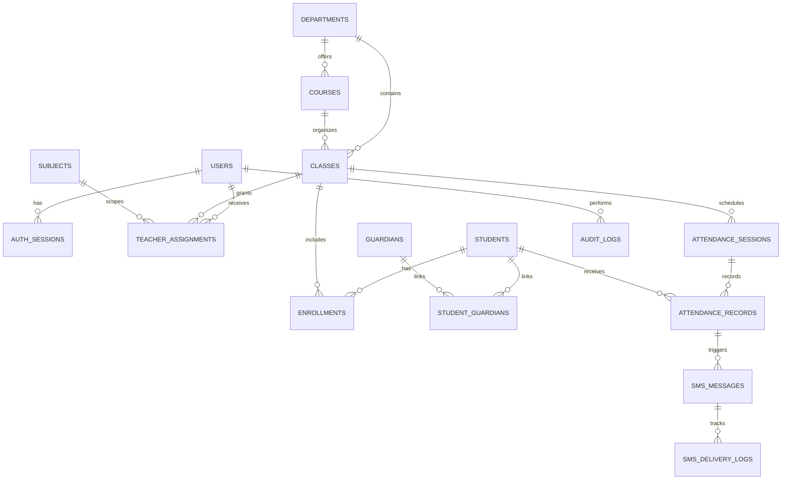

# CampusTrack entity relationships

Additional tables: `calendar_days` (optional class scope), `sms_templates`, and `settings`. The first migration creates all tables, foreign keys, indexes, and unique constraints. Enrollment start and end dates preserve class history. Attendance sessions have a `(class_id, day, session_key)` unique key and a version counter. Each student has one record per session. A teacher assignment can scope a class to a particular subject.
